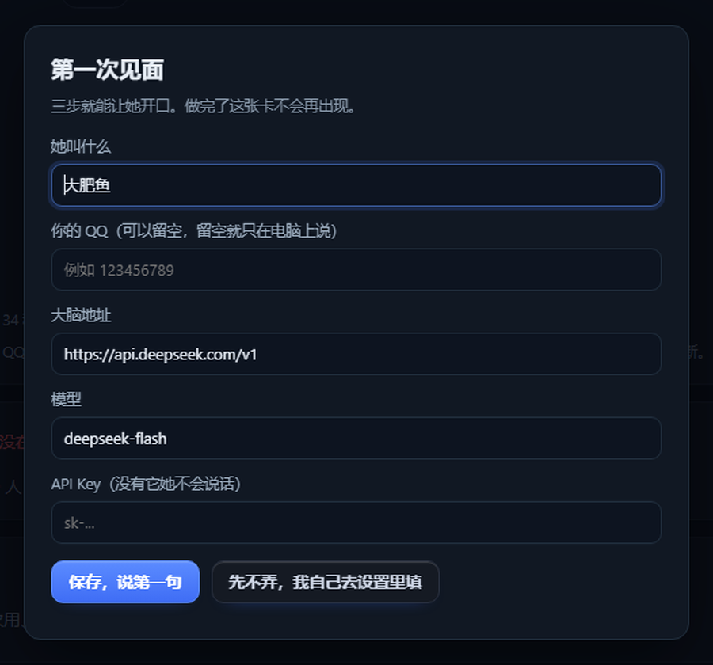
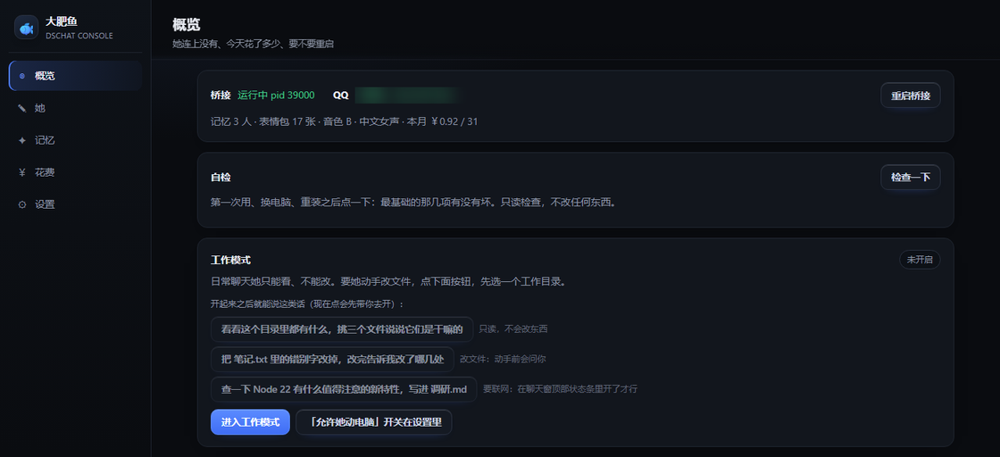

# DSChatBot · 住在你电脑里的数字人

> 她有自己的一天：有作息、有记性、会困、会主动找你说话；她在 QQ 或浏览器里都能跟你聊，记住的是"你"，不是"某个入口里的你"。
> *A digital person living on your Windows PC — with her own schedule, memory and moods. Talk to her on QQ, or in a browser.*

Windows · 本地数据 · 你自己的模型 Key · [MIT](LICENSE)

[](https://github.com/Z-Zr77/DSChatBot/actions/workflows/test.yml)
[](https://github.com/Z-Zr77/DSChatBot/releases)


*真实的聊天窗口。她记得你刚才说过的话（"我说过了，你得记着"），会给你出主意，也会真的说到困了去睡。*

---

## 她是什么

一个像真人的陪伴者，角色由每个用户自己定：女友、老婆、朋友……默认人设模板偏女友。

- **有她自己的一天**：早上会赖床、下午在忙自己的事、深夜真的会困到说不下去。
- **记得住你**：你说过的面试、你喜欢的歌、你昨天说的话，都在；记错了能被纠正，旧说法会标成作废。
- **会主动**：一天几次，按她的作息和时间挑时机，不是定时群发。
- **会给自己拍照**：你让她拍照，她画一张自己的照片发你；画完会自己看一眼，画面里有几个包子、手里拿的什么，她能说清。
- **两个入口，同一个人**：QQ 里聊的，和浏览器聊天窗里聊的，是同一份记忆、同一个她。

**她不是**：通用助手、代码 agent、不会替你把项目写完。读写文件这类"动手"能力是可选的，默认关。

---

## 技术概览

| | |
|---|---|
| 规模 | 运行时约 16k 行（Node ESM，**无构建步骤**）、52 个测试套件 |
| 进程 | Electron 主进程 + 控制台（3070）+ 桥接（3098）+ 聊天窗（3210）；接 QQ 走 OneBot v11（NapCat） |
| 存储 | 纯文件（JSON + JSONL），无数据库；升级 / 卸载都不动 `data/` |
| 模型 | 任意 OpenAI 兼容接口；画图/视觉、TTS 各接各的服务商，可以混用 |
| 长跑 | 日志轮转、热更新、月度预算四级熔断、断线重连与自恢复 |

**工程上真正要解决的问题**（细节见 [架构](docs/architecture.md)）：

- **多入口、同一份状态**：QQ 里聊的、浏览器窗口里聊的，是同一个记忆、同一个她——不是两个机器人共用一个名字。
- **她有自己的节奏**：回复延迟按分布抖动（2 秒 ~ 2 小时），允许"这次不回"；睡着会沉默，连敲几次才叫醒，被叫醒后再说"去睡"不会又排一整夜。
- **成本是一等公民**：每次模型调用按 `kind`/`channel` 记账，四级熔断（少说话 → 停主动 → 只被动 → 停），画图单独配额——因为一张图可能比几十轮对话还贵。
- **零构建 + 热更新**：源码即产物的 JS，改完拷进安装目录 `POST /api/restart` 生效；发布走 `pack/tools/release.cjs` 一键完成版本号 → 打包 → 发布包 → SHA256。

---

## 五分钟装上

1. 到 [Releases](../../releases) 下载 `DSChatBot-Setup-x.y.z.exe`，双击安装（默认 `E:\DSChatBot`，可改）。
2. 打开**控制台** `http://127.0.0.1:3070`。第一次会弹一张「第一次见面」的卡：

   

   给她起个名字、填 API Key（地址和模型有默认值）、点「保存，说第一句」——**她会当场回你一句**，回得出来就算装好了。
3. 装完自动打开**聊天窗**（`http://127.0.0.1:3210`）。没打开就去开始菜单，或直接开这个地址。
4. 想接 QQ（可选）：到控制台「QQ」页点「扫码登录 QQ」，你的 QQ（主人号）也在这页填；NapCat 路径按页面提示或托盘「设置向导」确认。

> 没有 Key 也能打开界面，但`自检`会红着一条告诉你缺什么。**不内置任何 Key，也不替你把聊天发到我们自己的服务器。**

卡住了先去「模型」页底部「更多」里点「自检」：十项最基础的东西，坏哪项、去哪儿修，它都写在那；也可以直接把 `http://127.0.0.1:3070/#doctor` 这条链接发给别人。

---

## 界面长什么样

**聊天窗**（3210）只有对话：消息、附件、输入框。没有面板、没有档位、没有状态条。

**控制台**（3070）才是设置的地方：



控制台侧栏六项，依次是 她 / QQ / 日志 / 人设 / 花费 / 模型：

| 页 | 作用 |
|---|---|
| 她 | 她现在在干什么、最近说了什么；「最近发生的事」在这 |
| QQ | 扫码登录 QQ、你的 QQ（主人号）、桥接状态与重启 |
| 日志 | 最近发生的事与运行日志——她没回你的时候来这儿看 |
| 人设 | 人物形象（参考图、长相描述）、人格提示词 `persona.md`（改这里就改她）、表情包；她记住的事从这页进入「记忆」 |
| 花费 | 本月用量、对账、熔断设置 |
| 模型 | 大脑 / 语音 / 识别 / 画图 / 看图五类能力、上网兴趣；底部「更多」里是**自检**、**允许她动电脑（默认关）**、备份 |

---

## 她能做什么（一览）

| 能力 | 说明 | 需要额外配置 |
|---|---|---|
| 聊天 | 私聊 / 群聊（群里被 @ 或被叫名字才说话） | 模型 Key |
| 人格 | `persona.md` 是唯一真源 | — |
| 记忆 | 强度随时间衰减；核心记忆不衰减；支持"被更正" | — |
| 作息与情绪 | 会累、会困、会自己说要睡；睡着不接话，连敲几次能叫醒 | — |
| 主动说话 | 每天有上限、有活跃时段，不刷屏 | — |
| 口头禁忌 | 主人说「别提 X」后，之后几轮不再提；目前只在软件内聊天窗生效，QQ、群聊和工作模式暂不适用 | — |
| 看图 / 听语音 | 收到图先理解再回；语音能听 | 视觉/语音 Key |
| 自己画图 / 自拍 | 文生图、参考图换装；画完自检画面 | 画图 Key |
| 语音条 | 发 QQ 语音 | TTS Key |
| 自己在网上看东西 | 按兴趣定时浏览 | — |
| 让她动电脑 | 默认关；开了才能读/改你指定的文件夹、跑命令，**每一步动手前都会问你**。命令有白名单（默认 node / npm / pnpm / python / pip 一类，`work.exec.allow` 可加），`node -e` 这种内联参数会被拒 | 见 [docs/work-mode.md](docs/work-mode.md) |

---

## 数据都在哪

```
<安装目录>\data\
  config.json     设置
  setup.json      模型地址/Key、QQ 号
  persona.md      她的人格
  agent-home\memory\   记忆条目 + 聊天日志
  work\sessions\       她动手时用的工作区（如果开了）
  ledger\              授权、快照、审计
```

- 全部在你自己电脑上。升级 / 卸载都**不会**删 `data`。
- 会发出去的只有：你发给她的话、拼好的提示词，发往**你自己填的**模型地址。
- 详见 [docs/privacy.md](docs/privacy.md)。

---

## 从源码跑

```bash
git clone https://github.com/Z-Zr77/DSChatBot.git
cd DSChatBot/pack
npm install
npm test          # 52 个测试套件
node launch.mjs   # 开发模式：控制台 + 桥接 + 聊天窗
```

打包：双击 `pack/build-exe.bat`，或 `npx electron-builder --win nsis`。需要 Node 20 及以上 / Windows 10 / 11。

---

## 文档

- [五分钟上手](docs/quickstart.md)
- [架构与模块划分](docs/architecture.md)
- [配置模型与 QQ](docs/configure.md)
- [记忆是怎么工作的](docs/memory.md)
- [允许她动电脑（可选）](docs/work-mode.md)
- [隐私](docs/privacy.md)
- [常见问题](docs/faq.md)
- [更新日志](CHANGELOG.md)

---

## 已知边界（先说清楚，免得误会）

- 只有 Windows 版；手机端没有。
- 她陪聊为主，不会写完整项目、不会上网替你查资料（联网是模型自己的事）。
- "允许她动电脑"是**文件工具的作用域**，不是进程沙箱：她跑 `npm install` 时那个进程有你的用户权限。
- 只有主人能让她动电脑；群里任何人都不能。
- 画图/语音质量取决于你接的服务。

---

## 许可

MIT。用之前请自己确认所在地对"AI 生成内容 + 自动回复"的规定。
